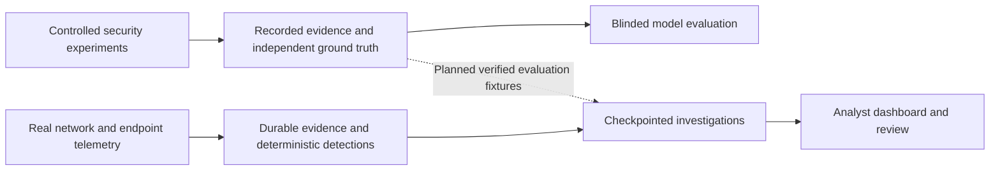

# Security Engineering & AI Research

Two complementary projects explore how to build security systems that can explain their conclusions through retained evidence: **CyberEval**, a controlled cybersecurity experimentation and model-evaluation platform, and **AgenticSOC**, an operational security monitoring and investigation platform using real residential telemetry.

The shared engineering approach combines explicit data contracts, deterministic controls, reproducible workflows and measurable outcomes. Model-generated conclusions remain separate from collected facts and independently established ground truth.

| Project | Purpose | Current scope |
| --- | --- | --- |
| **CyberEval / Wish-bone Security** | Produce recorded cybersecurity experiments and evaluate how models interpret their evidence | Research proof of concept with executed scenarios, retained artifacts, blinded evaluations and repeated-inference studies |
| **AgenticSOC** | Collect real telemetry, detect behavior and assemble traceable investigations | Running ingestion, deterministic detection, checkpointed local LangGraph workflows and a private analyst dashboard |

## CyberEval / Wish-bone Security

CyberEval turns a security hypothesis into a controlled experiment and a retained, evidence-linked trajectory. Its workflow separates scenario intent, execution, native telemetry, ground truth, control outcomes and model interpretation.

### Engineering highlights

- **Matched benign and malicious-intent scenarios.** Shared environments, collection settings and reviewed artifacts help isolate meaningful behavioral differences. A prohibited action that was prevented remains distinct from a successful attack.
- **Independent ground truth.** Orchestrator actions, return state, pre/postconditions, target state and cleanup establish expected outcomes independently of the evaluated model. The inspected historical examples use automated orchestrator review; human adjudication is a separate capability.
- **Linux and Windows evidence workflows.** Linux scenarios retain native eBPF telemetry and normalized events. Windows workflows define ETW/event-log collection, read-only retained snapshots and Rust/reference decoder parity. The Windows collector and decoder are owned by a separate sensor project.
- **Reproducible evidence lineage.** Stable run identities, versioned schemas, source/artifact hashes and retained manifests connect results to their inputs. Failed, superseded and invalid results are distinguished from accepted evaluation results.
- **Controlled execution.** Disposable isolated environments, bounded parallel workers, single-host/multi-host roles, explicit readiness gates and cleanup checks constrain scenario execution.
- **Blind model evaluation.** Deterministic, size-bounded projections exclude authoritative labels and ground truth from model inputs. Prompts, configuration, evidence and responses are retained with version/hash bindings.
- **Separate repeatability measurements.** Independent scenario executions measure experimental repeatability. Repeated inference over the same immutable evidence measures model consistency, citation behavior and recurring reasoning errors.

### Research findings

One retained consistency study evaluated **10 trajectories 10 times each**. Classification agreement within each trajectory was **100%**, while overall classification accuracy was **50%**. Consistent answers can therefore conceal consistent mistakes in this recorded setting.

Other retained examples show both directions of error: a benign protected-evidence trajectory classified as malicious in all ten repetitions, and a malicious resource-hijacking trajectory classified as benign in all ten repetitions. Classification stability does not imply stable reasoning or citation selection.

These findings apply to the recorded model, evidence projections, evaluator and scenarios. They are not a general performance claim about all models, and they do not establish that training on this corpus improves security capability.

The project also evaluates its own measurement pipeline. Recorded cases stop promotion or discount model results when an evidence projection omits the behavior being tested. That separates observability and evaluator defects from defensible model-performance findings.

## AgenticSOC

AgenticSOC applies evidence-oriented engineering to a functioning small security operations environment. It uses real firewall, network and endpoint telemetry while keeping infrastructure demands and model costs low.

### Running capabilities

- **Telemetry collection and normalization.** Existing pfSense syslog reception is preserved. Native Zeek connection, DNS and TLS records flow through acknowledged collection, a durable local inbox and versioned central parsers. Original evidence remains separate from normalized representations.
- **Evidence continuity and recovery.** Persistent offsets, stable evidence sequences, SHA-256 checks, retained snapshots, segmented storage and resumable consumers support traceability and recovery. Capture gaps and bounded-storage limits remain visible rather than being treated as complete coverage.
- **Deterministic detections.** Network rules identify destination-port fanout, host sweeps, TCP failure bursts, DNS NXDOMAIN bursts and established legacy TLS. Endpoint observations cover repeated SSH authentication failures and newly failed services. These are informational behavior observations, not automatic incident verdicts.
- **Separated collection and investigation.** An authenticated mutual-TLS evidence API serves a resumable client on a separate investigation node. Investigation inputs are constrained and locally cached.
- **Checkpointed LangGraph workflows.** Typed state, supervisor routing, network/endpoint specialist subgraphs and SQLite checkpoints produce evidence-linked reports with bounded execution, retries and reference budgets. Current execution is deterministic and local; it does not invoke an LLM.
- **Analyst-facing interface.** A private dashboard provides cached log search, collection coverage, investigation status, recorded detection context, relevant evidence fields, UTC event tables and full-record drill-down. Facts, hypotheses, unresolved questions and missing evidence are shown separately.
- **Review and evaluation.** Revision-bound operator labels, structural citation checks and response-plan review records support investigation assessment. Operator judgments are not independent ground truth; structural checks do not establish semantic accuracy.

### Governance and operating boundaries

Investigation agents have no arbitrary shell or firewall modification tools. Telemetry is treated as untrusted input. Runtime cloud inference is disabled; OpenAI is the selected initial provider behind a planned centralized gateway with minimized payloads and explicit usage budgets. Development Codex access is separate from runtime model credentials.

Response proposals and review decisions can be recorded, but **response execution is disabled**, including approved plans. The system does not automatically isolate endpoints or modify firewall rules.

This is a working engineering platform under active development, not a production-qualified enterprise deployment. Source-generation lifecycle, long-term retention, coverage gaps, broader operational qualification and model-assisted reasoning remain development areas. The current dashboard covers cached Zeek and endpoint records; full pfSense syslog browsing is not yet connected. Firewall monitoring also does not establish visibility into all endpoint-to-endpoint traffic.

## How the projects connect

CyberEval supplies the research methodology for testing security interpretation against controlled evidence. AgenticSOC supplies an operational setting for monitoring, detection and investigation. Importing verified CyberEval artifacts into AgenticSOC is **planned**, not implemented. The repositories and their execution boundaries remain independent.

## Development priorities

- Review and label operational investigations with explicit context and evidence limits.
- Expand verified scenario coverage and evaluate semantic citation quality.
- Add bounded model-assisted investigation through a single governed inference gateway.
- Integrate reviewed experimental fixtures without mixing ground truth into model inputs.
- Extend endpoint visibility, retention and distributed operation as measured capacity permits.

Implementation repositories and operational artifacts remain private. This public overview contains no residential telemetry, private network addresses, credentials or deployment configuration.

*Status summary: November 16, 2026. Historical research findings describe retained repository artifacts; the complete corpus and cloud experiments were not independently reproduced for this summary.*
